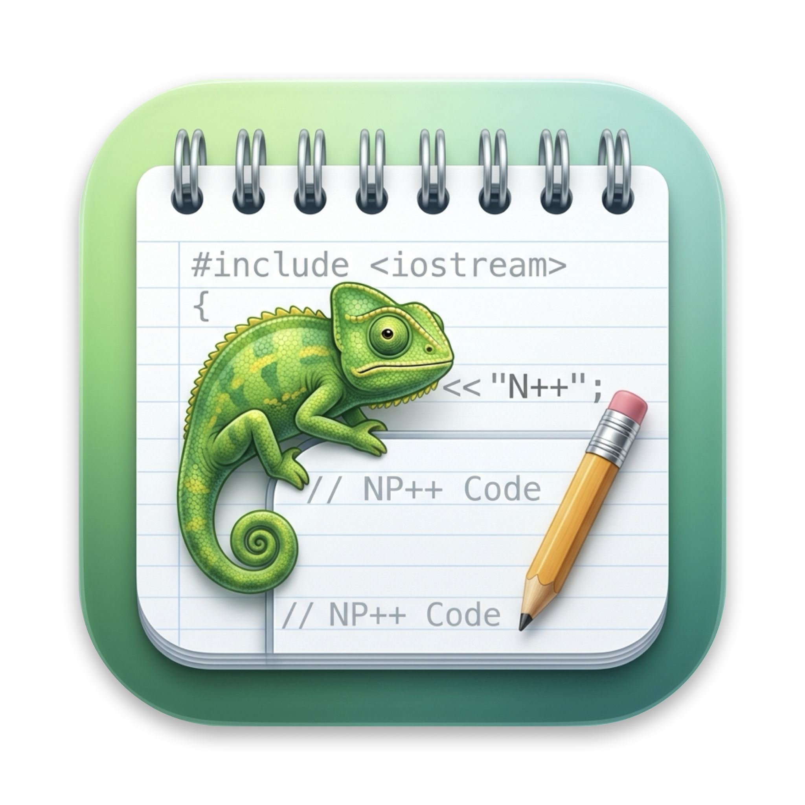
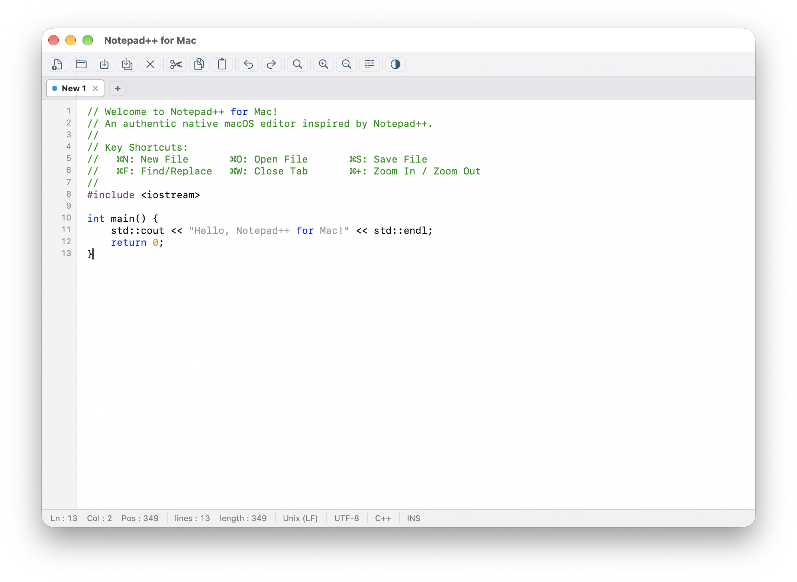

# Notepad++ for Mac 🦎

<p align="center">
  
</p>

<p align="center">
  <strong>An authentic, ultra-lightweight, native text editor inspired by Notepad++.</strong><br>
  Built with native Swift for macOS (AppKit) and iPad Air M3 / iPadOS (SwiftUI & UIKit TextKit).
</p>

<p align="center">
  
  
  
  
  
</p>

---

## 📸 Screenshot

<p align="center">
  
</p>

---

## ✨ Key Features

- **🚀 100% Native AppKit**: Instant launch time (< 0.2s), low RAM consumption (~40MB), zero Electron / web framework overhead.
- **🦎 Authentic Notepad++ Aesthetics**: Classic Green Chameleon mascot, Notepad squircle icon, and Scintilla-inspired color schemes (Light Classic & Dark Mode).
- **🎨 Multi-Language Syntax Highlighting**:
  - C / C++
  - Python
  - JavaScript / TypeScript
  - HTML / XML
  - JSON
  - Markdown
  - SQL
  - Swift
  - Shell / Bash
- **📑 Tabbed Multi-Document Interface**:
  - Classic Notepad++ status indicator dot (**Red** = modified/unsaved, **Blue** = clean/saved).
  - Quick tab closing, "+" new tab button, and keyboard navigation.
- **📏 Accurate Line Gutter Ruler**:
  - Synchronized line numbers perfectly aligned with text fragments.
- **🔍 Collapsible Find & Replace Bar (`⌘F`)**:
  - Find Next, Find Prev, Replace, Replace All, and Count occurrences.
  - Match case, whole word, and regular expression toggles.
- **📊 Real-Time Status Telemetry**:
  - `Ln`, `Col`, `Pos`, total `lines`, total `length`.
  - Line ending format (`Unix (LF)` / `Windows (CR LF)`).
  - File encoding (`UTF-8`).
  - Active syntax language and `INS` mode indicator.
- **📱 iPad Air M3 (11-inch) Optimizations**:
  - **Apple Pencil & Scribble**: Write code directly with Apple Pencil converted to text on the fly.
  - **On-Screen Coding Accessory Bar**: Instant touch access to `Tab`, `Untab`, `{}[]()<>;:"'=/`, cursor arrows, and Undo/Redo above the on-screen keyboard.
  - **Hardware Keyboard Support**: Full iPad Magic Keyboard / Smart Keyboard desktop shortcut integration.
  - **iPadOS Files App Integration**: Open and save files anywhere in iCloud Drive, local iPad storage, or external USB-C storage drives.
  - **Stage Manager & Split View**: Full adaptive layout for portrait, landscape, and resizable multitasking windows.

---

## ⌨️ Keyboard Shortcuts

| Shortcut | Action |
| :--- | :--- |
| `⌘N` | New Document / Tab |
| `⌘O` | Open File(s)... |
| `⌘S` | Save Active Document |
| `⇧⌘S` | Save All Documents / Export As |
| `⌘W` | Close Current Tab |
| `⌘F` | Toggle Find & Replace Bar |
| `⌘+` / `⌘-` | Zoom In / Zoom Out Font Size |
| `⌘Z` / `⇧⌘Z` | Undo / Redo |

---

## 📦 Installation & Deployment

### 🖥️ macOS
1. Download the latest **`Notepad++ for Mac.dmg`** from [Releases](https://github.com/irobov3/notepad-4-MAC/releases).
2. Double-click the DMG and drag **`Notepad++ for Mac`** into your **`Applications`** folder.
3. *First Launch*: Right-click `Notepad++ for Mac` in Applications and choose **Open**.

### 📱 iPad Air M3 (11-inch)

#### Method 1: Deploy with Xcode (Recommended)
1. Connect your **iPad Air M3** to your Mac via USB-C or over Wi-Fi.
2. Run the deployment script:
   ```bash
   ./open_in_xcode.sh
   ```
3. In Xcode, choose your connected iPad Air M3 in the run destination selector at the top.
4. Press **`⌘R` (Run)** to build and install Notepad++ directly onto your iPad!

#### Method 2: Apple Swift Playgrounds on iPad
1. AirDrop or copy the **`NotepadPlusPlus.swiftpm`** folder to your iPad Air M3.
2. Tap the project to open it directly in the free **Swift Playgrounds** app on your iPad.
3. Tap **Run** to compile and run Notepad++ on-device without a Mac!

---

## 🛠️ Building from Source

### Prerequisites
- macOS 14.0 (Sonoma) or newer on Apple Silicon (`arm64`).
- Xcode Command Line Tools or Xcode 15+.

### macOS Build
```bash
# Compile and install to /Applications/NotepadMac.app
./build.sh

# Create the distributable installer DMG
./package_dmg.sh
```

---

## 📜 Credits & License

- **Developer**: Developed by [iRoBo](https://github.com/irobov3).
- **Inspiration**: Inspired by [Notepad++](https://notepad-plus-plus.org) by Don Ho.
- **License**: Released under the [MIT License](LICENSE).
